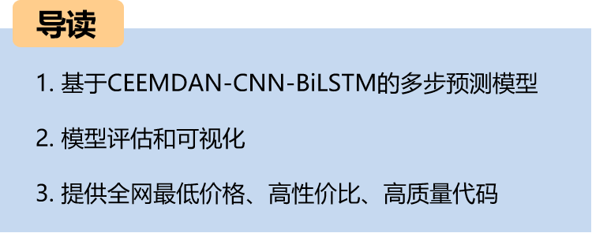
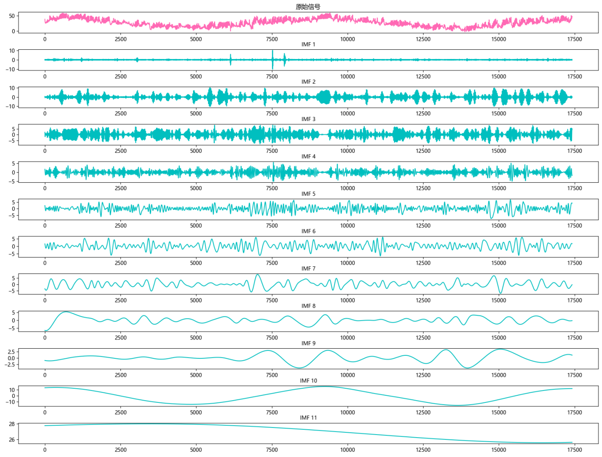
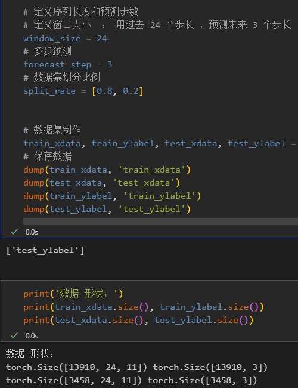
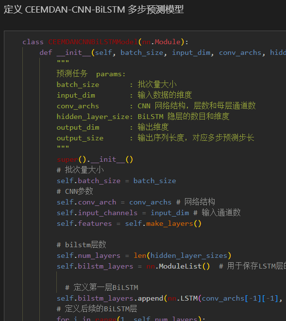
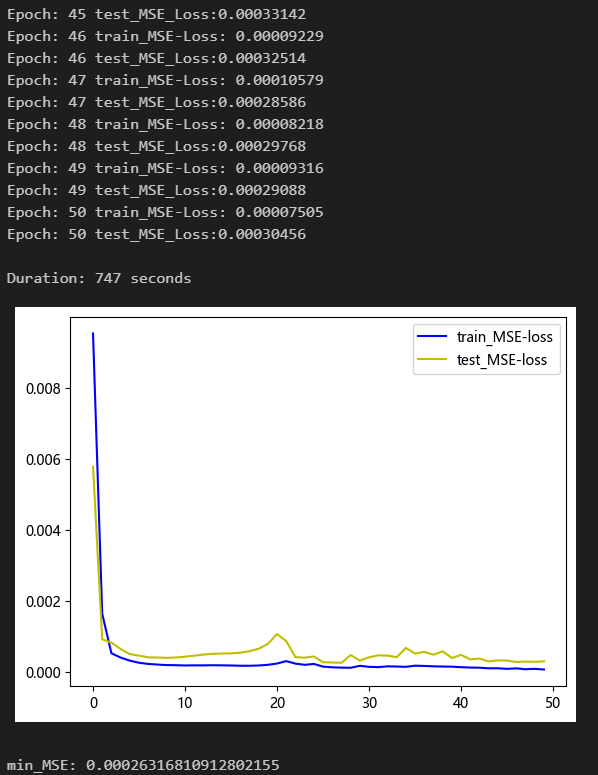
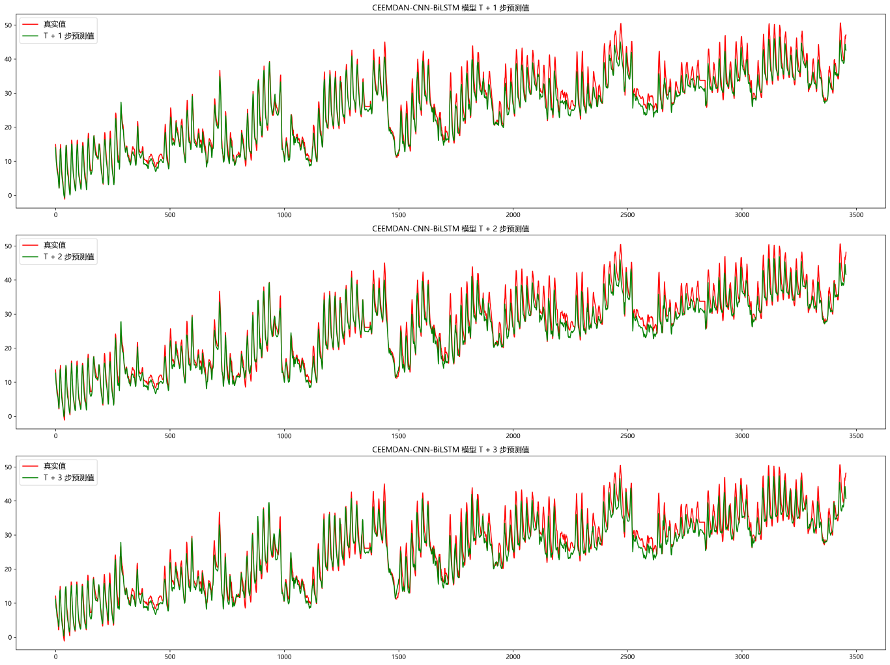
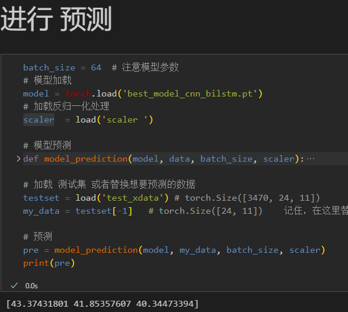
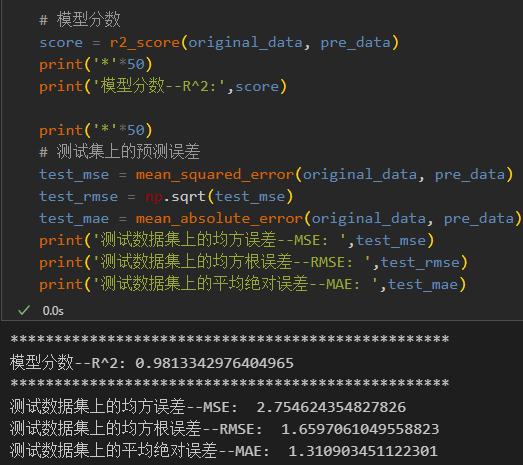
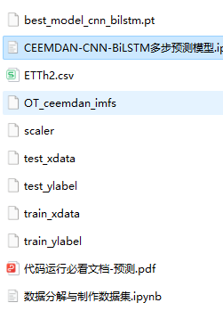

# CEEMDAN-CNN-BiLSTM Multi-Step Prediction Model

● Environment Framework: Python 3.9, PyTorch 1.8 and above can be run.
● Usage Object: Paper requirements, graduation design requirements.
● Code Guarantee: The code comments are detailed and ready to run.
Including complete process data code processing:
Multi-step prediction dataset creation, data loading, model definition, parameter setting, model training, model testing, prediction visualization, multi-step prediction, model evaluation.
Code and file introductions are provided:
Preface
This paper introduces a multi-feature, multi-step prediction model based on the CEEMDAN-CNN-BiLSTM network, which is introduced in the previous introduction of power transformers (data set attached at the end).
The detailed introduction to the power transformer dataset can be found in the following text:
Introduction to the Power Transformer Dataset and Preprocessing
1 Data Preprocessing and Visualization of Electric Power Transformers
1.1 Import data
1.2 CEEMDAN Decomposition
\t1.3 Multi-step Preprocessing
2. Multivariate multi-step prediction model based on CEEMDAN-CNN-BiLSTM
2.1 Define CEEMDAN-CNN-BiLSTM Network Model
\t  
2.2 Set parameters and train the model
50 epochs, MSE is 0.000263, the CEEMDAN-CNN-BiLSTM multi-step prediction model has a significant predictive effect. The model can fully extract the spatiotemporal features of sequences, converges quickly, and performs excellently with high accuracy in predictions. By appropriately adjusting model parameters, further improvements in model predictive performance can be achieved.
\tNote: Adjust parameters.
\tIt is appropriate to increase the number of CNN layers and the number of channels per layer.
\tChange the number of BiLSTM layers and the number of neurons per layer, increasing more epochs (note to prevent overfitting)
\tThe sliding window length can be changed (set the appropriate window length).
3 Results Visualization and Prediction, Model Evaluation
3.1 Visualization of Prediction Results
3.2 Load the model for prediction
3.3 Model Evaluation
Previously Featured Content:
Time Series Forecasting: Analysis and comparison of LSTM, ARIMA, Holt-Winters, SARIMA models
Wind Speed Prediction (Part 1) Data Set Introduction and Preprocessing
Wind Speed Prediction (II) EMD-LSTM Model Based on Pytorch
Wind Speed Prediction (III) EMD-LSTM-Attention Model
Wind Speed Prediction (IV) EMD-Transformer Model Based on Pytorch
Wind Speed Prediction (5) EMD-CNN-LSTM Model Based on Pytorch
Wind Speed Prediction (VI) - EMD-CNN-GRU Parallel Model Based on Pytorch
CEEMDAN + Combination Forecasting Model (BiLSTM-Attention + ARIMA)
CEEMDAN + Combination Forecasting Model (CNN-LSTM + ARIMA)
CEEMDAN + Combination Forecasting Model (Transformer - BiLSTM + ARIMA)
CEEMDAN + Combination Forecasting Model (CNN-Transformer + ARIMA)
Multi-feature Variable Sequence Prediction (I) - CNN-LSTM Wind Speed Prediction Model
Multi-feature Variable Sequence Prediction (II) - CNN-LSTM-Attention Wind Speed Prediction Model
Multi-feature Variable Sequence Prediction (III) - CNN-Transformer Wind Speed Prediction Model
Multi-feature Variable Sequence Prediction (IV) - Transformer-BiLSTM Wind Speed Prediction Model
Multi-feature Variable Sequence Prediction (V) CEEMDAN+CNN-LSTM Wind Speed Prediction Model
Multi-feature Variable Sequence Prediction (VI) CEEMDAN+CNN-Transformer Wind Speed Prediction Model
Prediction Model Based on the Particle Swarm Optimization Algorithm SSA: CEEMDAN-BiLSTM-Attention
Prediction Model Based on the Particle Swarm Optimization Algorithm SSA: CEEMDAN-Transformer-BiGRU
Superior Prediction Model: Secondary Decomposition-Combination Prediction
Multi-Feature Variable Sequence Prediction (Part 7) CEEMDAN+Transformer-BiLSTM Prediction Model
Multi-Feature Variable Sequence Prediction (Part 8) CEEMDAN-SSA-BiLSTM Prediction Model Based on the Particle Swarm Optimization Algorithm
Multi-Feature Variable Sequence Prediction (Part 11) TCN-GRU Prediction Model Based on Pytorch
VMD + CEEMDAN Secondary Decomposition, CNN-LSTM Prediction Model
VMD + CEEMDAN Secondary Decomposition, CNN-Transformer Prediction Model
VMD + CEEMDAN Secondary Decomposition, Transformer-BiGRU Prediction Model
Prediction Model Based on the Particle Swarm Optimization Algorithm SSA: Code All-in-One Kit
Introduction to the Power Transformer Data Set and Preprocessing
 | Sci-Tech 1st Class High Innovation Prediction Model!
END

## Images

<!-- PAYMENT_BLOCK -->

## Get this dataset

- Payment link (Stripe): [Buy now](https://buy.stripe.com/3cs8yP7sY87d0vu9AB)
- Payment QR code: 

<!-- /PAYMENT_BLOCK -->
